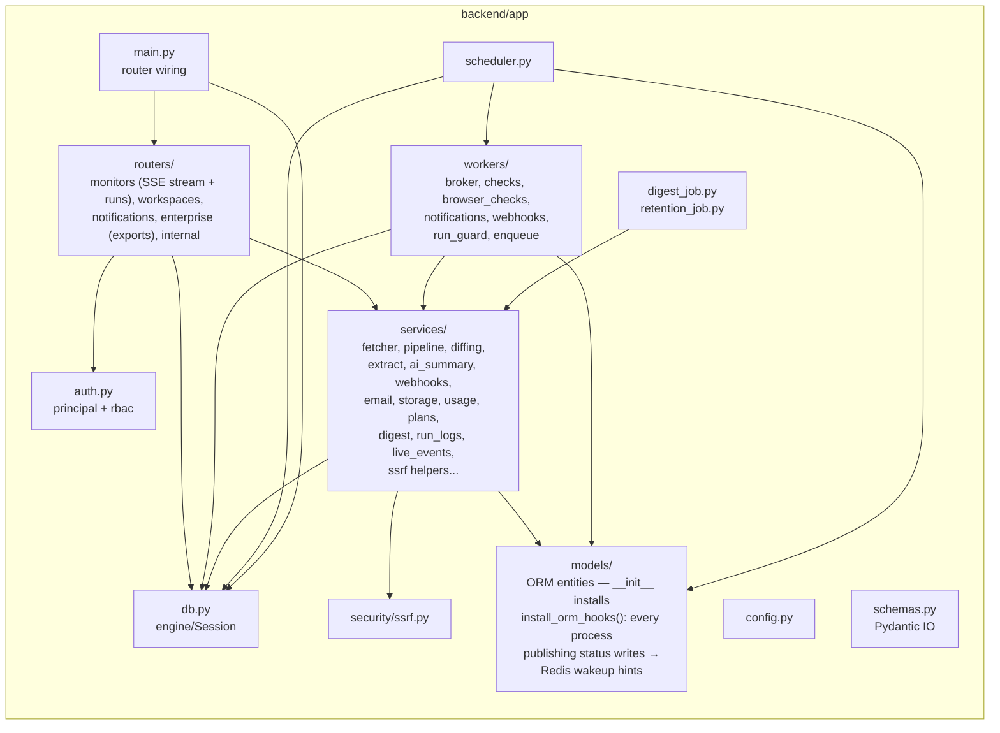
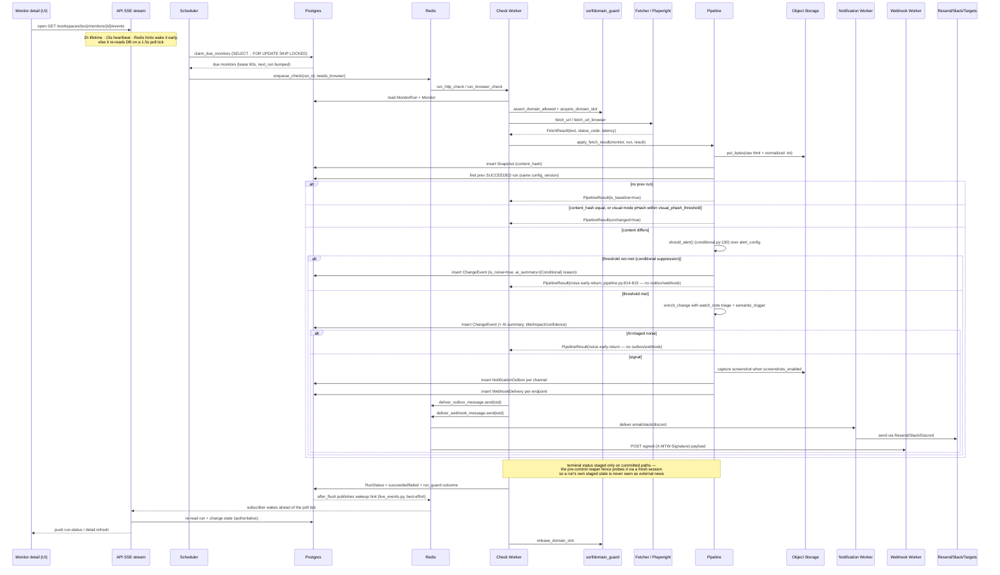
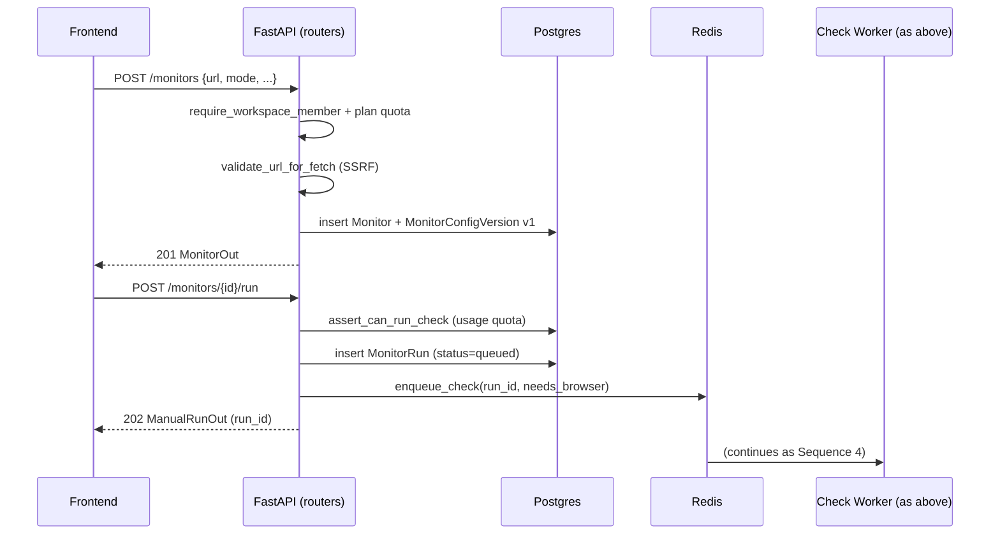
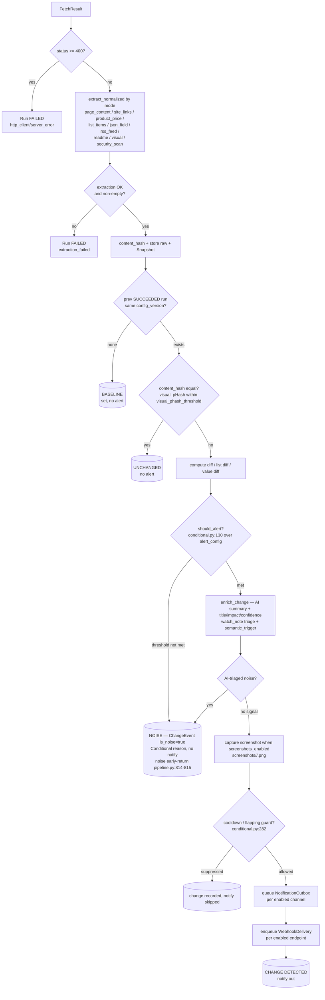
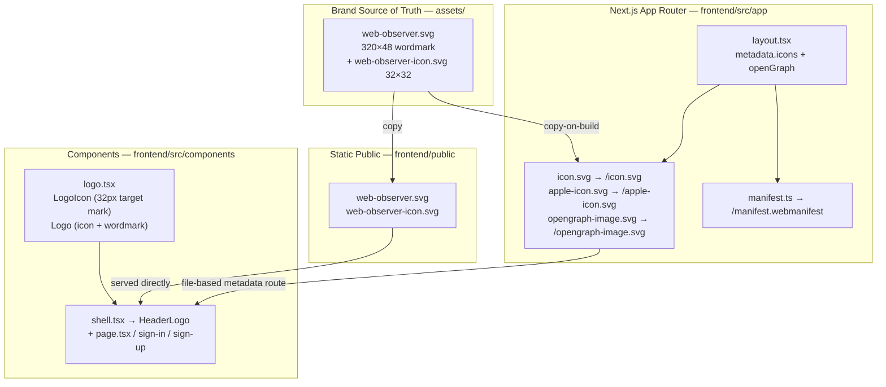

  

# Web Observer — Architecture as UML

Generated from a code review of the `backend/` and `frontend/` trees.
Stack: FastAPI + Dramatiq/Redis workers, Next.js, Neon Postgres, Clerk, Resend, local-disk (or S3-compatible) object storage, optional Playwright.

## 1. Component / Deployment Diagram

```mermaid
flowchart TB
    subgraph Client
        UI["Next.js Frontend :3000"]
    end
    subgraph APIProc["API process (uvicorn)"]
        API["FastAPI app.main:app\n/health /ready /api/v1/*"]
        AUTH["auth.py\nClerk JWT + mtw_ API keys + X-Internal-Token"]
        RUNS["routers/monitors.py\nGET /workspaces/{id}/runs (Logs) + CSV/JSON\nexport via services/run_logs.py"]
        LIVE["SSE stream\nGET /monitors/{id}/events\n1h lifetime, 15s heartbeats,\n1.5s poll-tick fallback"]
    end
    subgraph SchedProc["Scheduler process"]
        SCHED["app.scheduler\nclaim_due_monitors + lease + reap"]
    end
    subgraph WorkerProc["Worker processes (dramatiq)"]
        HTTPW["run_http_check (http_checks)"]
        BROWW["run_browser_check (browser_checks)\nPlaywright"]
        NOTIFW["deliver_outbox_message (notifications)"]
        WEBHW["deliver_webhook_message (notifications)"]
        AIEW["enrich_change_event (ai_enrich)"]
        BRANDW["enrich_monitor_brand (http_checks)"]
    end
    subgraph LoopProc["Standalone loop processes (not dramatiq)"]
        DIGEST["python -m app.digest_job [--loop]\npoll digest_poll_seconds=300s"]
        RETENT["python -m app.retention_job\nsnapshot_retention_days=30 / run_retention_days=90"]
    end
    subgraph External
        CLERK["Clerk (auth + JWKS)"]
        RESEND["Resend (email)"]
        CHAT["Slack / Discord webhooks"]
        TARGET["Monitored web pages"]
    end
    subgraph Edge["Cloudflare edge (optional, $0 tier)"]
        CFW["Worker: browser-failover\nedge Chromium, failover only\n(~10 min browser time/day)"]
        CFS["Worker: share-cache\nedge cache for /share/ + /_next/static/"]
        SCAN["Cloudflare URL Scanner\nsecurity_scan mode verdicts"]
    end

    NEO[("Neon Postgres")]
    REDIS[("Redis\nDramatiq broker · rate limits ·\nSSE wakeup pub/sub (best-effort hints)")]
    OBJ[("Object storage\nlocal disk or S3 snapshots")]

    UI -->|"HTTPS + Bearer/JWT"| API
    UI -->|"opens SSE /monitors/{id}/events\n+ receives run-status events"| LIVE
    UI -->|"public share pages + /_next/static/"| CFS
    CFS -->|"cached response"| UI
    API --> AUTH
    AUTH --> CLERK
    API --> NEO
    API --> RUNS
    SCHED --> NEO
    SCHED -->|"enqueue_check"| REDIS
    API -->|"manual run / import"| REDIS
    REDIS -->|"http_checks"| HTTPW
    REDIS -->|"browser_checks"| BROWW
    REDIS -->|"notifications"| NOTIFW
    REDIS -->|"notifications"| WEBHW
    REDIS -->|"http_checks"| AIEW
    REDIS -->|"http_checks"| BRANDW
    HTTPW -.->|"run-status writes publish\nafter_flush wakeup hints"| REDIS
    LIVE -->|"re-reads authoritative\nrun state every tick"| NEO
    HTTPW -->|"fetch_url"| TARGET
    BROWW -->|"fetch_url_browser / screenshot"| TARGET
    BROWW -->|"failover: local fetch failed"| CFW
    CFW --> TARGET
    BROWW -->|"security_scan mode"| SCAN
    SCAN --> BROWW
    HTTPW --> NEO
    BROWW --> NEO
    AIEW --> NEO
    BRANDW --> NEO
    HTTPW --> OBJ
    BROWW --> OBJ
    BRANDW --> OBJ
    DIGEST --> NEO
    DIGEST --> RESEND
    RETENT --> NEO
    RETENT --> OBJ
    API -->|"GET /public/assets/{object_key}\n(brand-assets/ + screenshots/ only)"| OBJ
```

## 2. Backend Module Structure (Package Diagram)

## 3. Data Model (Class Diagram / ERD)

```mermaid
classDiagram
    class User {
        +UUID id
        +String clerk_user_id
        +String email
    }
    class Workspace {
        +UUID id
        +String name
        +String plan  free|pro|business|enterprise
        +String digest_cadence  none|daily|weekly
        +bool ai_summaries_enabled
    }
    class WorkspaceMember {
        +UUID id
        +UUID workspace_id
        +UUID user_id
        +String role  owner|admin|member|viewer
    }
    class Monitor {
        +UUID id
        +UUID workspace_id
        +String url
        +String mode  page_content|site_links|product_price|list_items|json_field|visual|rss_feed|readme|security_scan
        +String css_selector  (list_items/json_field selector or JSONPath)
        +bool js_required  (true routes to browser_checks queue)
        +bool screenshots_enabled  (capture screenshot on signal)
        +String watch_note  (AI triage hint)
        +String semantic_trigger  (plain-English alert rule)
        +JSON alert_config  (conditional thresholds, migration 011)
        +JSON brand  (title/description/logo_url/hero_url)
        +JSON tags  (up to 10 strings — migration 013; API + bulk import, no UI yet)
        +int schedule_interval_minutes
        +bool enabled
        +int config_version
        +DateTime next_run_at
        +String lease_owner
    }
    class MonitorConfigVersion {
        +UUID id
        +UUID monitor_id
        +int version
    }
    class MonitorRun {
        +UUID id
        +UUID monitor_id
        +UUID workspace_id
        +String status  scheduled|queued|running|succeeded|failed|cancelled|skipped
        +String content_hash
        +UUID snapshot_id
    }
    class Snapshot {
        +UUID id
        +UUID monitor_id
        +UUID run_id
        +String content_hash
        +String raw_object_key
        +String text_object_key
    }
    class ChangeEvent {
        +UUID id
        +UUID monitor_id
        +UUID run_id  (nullable — migration 015 SET NULL; events survive run/monitor cleanup)
        +UUID new_snapshot_id
        +UUID previous_snapshot_id
        +String diff_summary
        +String ai_summary  (the model's own summary; a marker line prefixes it when the change was held back)
        +String title  (migration 012)
        +String impact  critical|high|medium|low (012)
        +float confidence  0.0-1.0 (012)
        +bool is_noise
        +String noise_reason  (triage reason on the marker line of ai_summary, no dedicated column)
        +bool is_read
    }
    class NotificationChannel {
        +UUID id
        +UUID workspace_id
        +String type  email|slack|discord
        +String address
    }
    class NotificationOutbox {
        +UUID id
        +UUID change_event_id
        +UUID channel_id
        +String status  pending|processing|sent|failed
    }
    class NotificationDelivery {
        +UUID id
        +UUID outbox_id
        +String provider_message_id
    }
    class WebhookEndpoint {
        +UUID id
        +UUID workspace_id
        +String url
        +String secret  (encrypted at rest — migration 014)
    }
    class WebhookDelivery {
        +UUID id
        +UUID endpoint_id
        +String event_type
    }
    class ApiKey {
        +UUID id
        +UUID workspace_id
        +String key_hash
        +String key_prefix
    }
    class ShareLink {
        +UUID id
        +UUID workspace_id
        +UUID monitor_id
        +String token_hash  (opaque token in URL, hash stored)
        +String token_prefix
        +bool enabled
    }
    class WorkspaceInvite {
        +UUID id
        +UUID workspace_id
        +String token_hash
        +String token_prefix
        +String role
        +int max_uses
        +int use_count
    }
    class AuditLog {
        +UUID id
        +UUID workspace_id
        +String action
    }
    class UsageCounter {
        +UUID id
        +UUID workspace_id
        +int checks_count
        +int notifications_count
        +int storage_bytes
    }

    User "1" --> "*" WorkspaceMember
    Workspace "1" --> "*" WorkspaceMember
    Workspace "1" --> "*" Monitor
    Workspace "1" --> "*" NotificationChannel
    Workspace "1" --> "*" WebhookEndpoint
    Workspace "1" --> "*" ApiKey
    Workspace "1" --> "*" AuditLog
    Workspace "1" --> "*" UsageCounter
    Workspace "1" --> "*" ShareLink
    Workspace "1" --> "*" WorkspaceInvite
    Monitor "1" --> "*" ShareLink
    Monitor "1" --> "*" MonitorConfigVersion
    Monitor "1" --> "*" MonitorRun
    MonitorRun "1" --> "0..1" Snapshot
    ChangeEvent "1" --> "0..1" Snapshot : new (new_snapshot_id)
    ChangeEvent "1" --> "0..1" Snapshot : previous (previous_snapshot_id)
    ChangeEvent "1" --> "*" NotificationOutbox
    NotificationChannel "1" --> "*" NotificationOutbox
    NotificationOutbox "1" --> "*" NotificationDelivery
    WebhookEndpoint "1" --> "*" WebhookDelivery
```

## 4. Sequence Diagram — Scheduled Live Check

## 5. Sequence Diagram — Manual / API-Triggered Run

## 6. Pipeline Decision Flow (Activity Diagram)

## 7. Frontend Architecture & Brand System

**Brand spec — `assets/web-observer.svg:1` / `frontend/src/components/logo.tsx:15`**

* Mark: 32×32 (36×36 at 18px center) — `slate-900` rounded square `rx 9.5`, hairline track `r 9.5 @ 14% white`, scanning arc `sky-400 #38bdf8 1.55px` `M 16 6.5 A 9.5 9.5`, ping `r1.35 + r2.45@18%`, middle ring `r5.9 1.35px white 95%`, center dot `r2.35 white`. No literal eye / no zig-zag — reads at 16px favicon.
* Wordmark: `Inter 700 -0.03em` `Web #0f172a → #f8fafc (dark)` + `Observer 500 #64748b → #cbd5e1 (dark)`; SVG embeds `@media (prefers-color-scheme: dark)` so `assets/web-observer.svg` is theme-aware; React `Logo` uses `text-slate-900/dark:text-white` + `text-slate-500/dark:text-slate-300`.
* Assets: source in `assets/` (also `frontend/public/` for direct serving, `frontend/src/app/` for Next.js file-based metadata). Root `README.md` header uses `assets/web-observer.svg` (320w).

## Notes

* **Auth modes** (`auth.py`): Clerk JWT (`Authorization: Bearer`), workspace API keys (`mtw_...`), and internal token (`X-Internal-Token`) for dev/smoke tests. RBAC via `require_workspace_member` / `require_role(min_role)`.
* **Mode routing** (`workers/enqueue.py`): monitors with the `js_required` flag route to the `browser_checks` queue (Playwright); everything else goes to `http_checks`. (`site_links` rejects `js_required` at the schema layer since sitemaps are fetched over plain HTTP.)
* **Outbox pattern**: change detection writes `NotificationOutbox` + `WebhookDelivery` rows, then workers fan out. This decouples detection from delivery and gives at-least-once send with retry (`max_retries=5`).
* **Rate limiting** (`app/rate_limit.py`): default 60/min per verified principal (or IP), enforced on every route by `SlowAPIMiddleware` (decorated endpoints keep stricter limits). Counters are shared via Redis; when Redis is unreachable the limiter **fails open** to per-process in-memory counters with automatic recovery (`in_memory_fallback_enabled`), so a Redis outage cannot turn unrelated requests into 500s.
* **Delivery reliability (review follow-ups)**: outbox and webhook sends claim rows atomically (`PENDING→PROCESSING`) with an attempts cap and a reaper that re-enqueues abandoned rows; usage counters use Postgres `ON CONFLICT` upserts + atomic increments; the browser-check daily quota is plan-aware with a once-per-run reservation; the stuck-run reaper uses a fenced conditional `UPDATE...WHERE status`, and `run_guard` refuses to run hooks/claims for runs not in `scheduled`/`queued` — preventing double-sends after retries.
* **SSRF guard** (`security/ssrf.py`): blocks private/loopback/link-local/metadata IPs and credentialed URLs before any fetch; redirects are re-validated in the fetcher. The pinned fetcher (`services/fetcher.py:_pinned_get`) tries every validated IP in turn, so one dead CDN PoP can't fail a check — only connect-level errors trigger failover. `readme` monitors hit the GitHub API first (`ref`-pinned to the parsed `/tree/<branch>` branch when there is one, default-branch otherwise), then fall back to raw probes bounded by a wall-clock budget.
* **Cloudflare Browser Rendering failover** (`services/browser_fetch.py`): local Playwright is always the primary path. Only when a local browser fetch has *actually failed* does the check retry once against the edge Worker (`CLOUDFLARE_BROWSER_URL`, token in `CLOUDFLARE_BROWSER_TOKEN`). The edge is a separate trust boundary: the Worker returns raw HTML, so the backend re-applies SSRF validation to the *final* URL, the size caps, and bot-challenge detection on the way back in. The free tier allows ~10 minutes of browser time per UTC day, which is why local stays primary. Worker source: `workers/browser-failover/`; covered by `backend/tests/test_browser_failover.py`.
* **`security_scan` mode** (`services/security_scan.py`): the URL is submitted to the Cloudflare URL Scanner and the result is flattened into a deterministic one-fact-per-line digest (`malicious=`, `categories=`, `tags=`, `task.status=`, `task.apexDomain=`, `certificate=`, `server=`, `asn=`, `tech=`). Volatile counters are deliberately excluded so an unchanged page does not alert on noise, and the fact list diffs as an item set. The mode needs `CLOUDFLARE_ACCOUNT_ID` + `CLOUDFLARE_URLSCANNER_TOKEN`; without a token the check fails loudly instead of silently passing. It renders on Cloudflare's edge, so `js_required` is rejected.
* **Screenshot storage** (`services/storage.py`): object keys starting with `screenshots/` route to `S3_SCREENSHOT_BUCKET` when it is set, so screenshots can live in a separate public bucket behind a CDN custom domain (`NEXT_PUBLIC_SCREENSHOT_CDN_URL`) while snapshots and brand assets stay in the primary bucket behind the API's asset proxy. The bucket is chosen per key, not per process.
* **Observability**: `GET /metrics` serves Prometheus-compatible text (monitors total, runs and changes in the last 24h, outbox and webhook backlog). It is rate limited to 30/minute like every other route.
* **Newer endpoints not in the diagrams above**: `GET .../runs` (workspace run logs, shared filters via `services/run_logs.py`), `GET .../export/runs` (CSV/JSON, 20k-run cap, audited), `GET .../monitors/{id}/events` (SSE live run status), `GET .../changes/activity` (dashboard card), `POST .../monitors/pause-all` / `resume-all`, `POST .../monitors/selector-preview` + `.../brand-info` (picker + brand auto-fill), `POST .../alerts/read-all`, `GET .../snapshots/{id}`, `POST .../changes/{id}/ask-ai` (change Q&A), `GET .../monitors/{id}/badge.svg` (public status badge), `GET .../monitors/{id}/value-history` (price/JSON series), `GET /metrics` (Prometheus).
* **Live status streaming** (`services/live_events.py`): an ORM `after_flush` hook installed in `models/__init__.py` publishes best-effort Redis hints on every `MonitorRun.status` write site (pipeline, workers, scheduler, reaper) — one hook instead of ~15 instrumented call sites. The SSE endpoint always re-reads authoritative state from Postgres before emitting, so a lost or spurious hint changes latency only, never correctness. Without Redis the publisher circuit-breaks and the stream falls back to a 1.5s poll tick.
* **Run-status staging** (`services/pipeline.py`): the terminal `SUCCEEDED` status is staged only on paths that commit immediately, so the pre-commit reaper fence never reads a run's own staged value as external news (a reaper bug once rolled back genuine changes on the *changed* path); the fence probe goes through a fresh session.
* **Quotas/plans** (`services/usage.py`, `services/plans.py`): daily check/notification/storage counters per workspace, gated by plan.
* **Crypto purpose separation** (`services/crypto.py`): Fernet keys, share-link/invite tokens, and API-key hashes are each derived from `SECRET_KEY` via HKDF with distinct purpose labels; `v2` formats keep verifying legacy `v1`/plaintext schemes for backward compatibility (no data migration required).
* **ReDoS/size caps**: `must_match`/`must_not_match` regexes and CSS selectors are validated and capped at the schema layer (pattern count, length) and enforced again at runtime in `extract.py`/`conditional.py` (`_bounded_search`); oversized/invalid `must_match` patterns suppress with a reason (fail-closed).
* **Lease + reaper**: scheduler claims monitors with a 60s lease; `run_reaper` recovers stuck runs so HA scheduler/workers don't double-run.
* **Branding pipeline**: `assets/` is the source of truth; `frontend/public/web-observer.svg` and `web-observer-icon.svg` are the static copies; `frontend/src/app/icon.svg` etc are Next.js metadata routes (generates `/icon.svg`, `/manifest.webmanifest`). `LogoIcon` is inline SVG (not ``) so it inherits Tailwind theming and scales via `size` prop (`shell.tsx:49` `iconSize={36}`). OG image `opengraph-image.svg` (1200×630) is served from `src/app` and referenced in `layout.tsx`.
